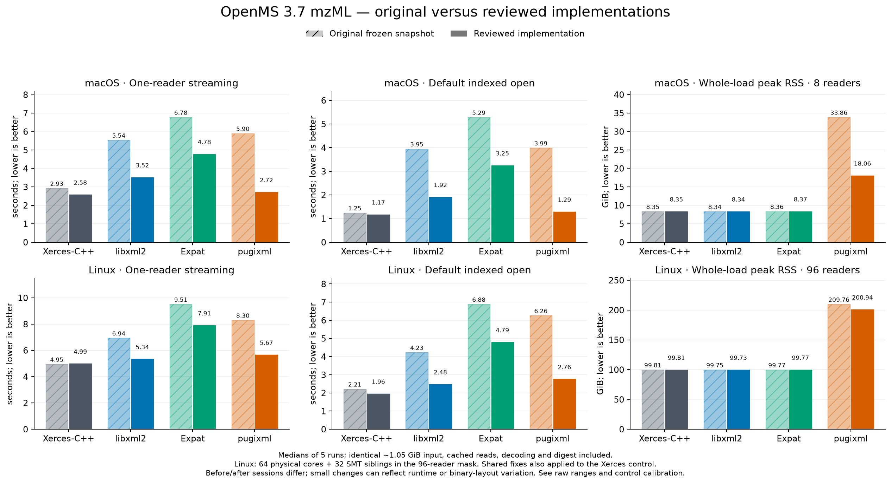
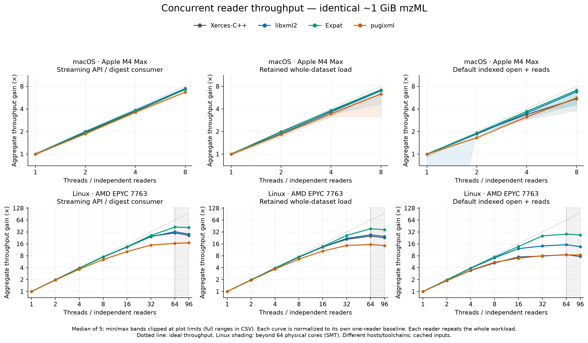
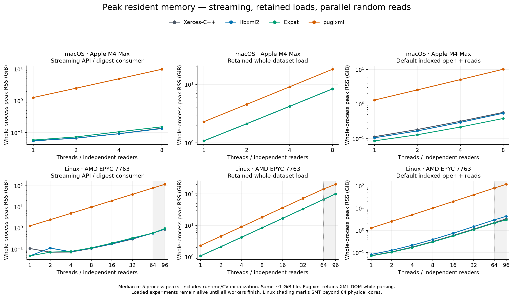

# OpenMS 3.7 XML parser handoff: reviewed and optimized

Follow-up to [Timo’s comment on #10623](https://github.com/OpenMS/OpenMS/issues/10623#issuecomment-6264980988). Three independent branches start at OpenMS 3.7/develop [`77cccda7caf40`](https://github.com/OpenMS/OpenMS/commit/77cccda7caf40b46a4919d33748450270eccd565): [libxml2](https://github.com/okohlbacher/OpenMS/tree/feature/xml-libxml2-poc), [Expat](https://github.com/okohlbacher/OpenMS/tree/feature/xml-expat-poc), [pugixml](https://github.com/okohlbacher/OpenMS/tree/feature/xml-pugixml-poc). These replace actual OpenMS event delivery and indexed mzML decoding. Libxml2 also replaces XSD validation. **All three remain migration prototypes with residual Xerces dependencies.**

## Recommendation

Advance libxml2 for migration coverage: streaming, DOM and XSD 1.0 in one library. Expat remains a streaming/fragment option requiring separate DOM/XSD support. Pugixml merits consideration for fragments; its whole-file event adapter still builds a DOM, with substantial memory growth under concurrent reads. Keep the measured Xerces implementation as the performance and compatibility reference. These are OpenMS adapter/workload measurements, not universal XML tokenizer rankings.

Both macOS ARM64 and Linux x86-64 were tested. Windows was not run. Independent readers through 96 Linux threads establish evidence for this usage, not shared-reader safety or race freedom. See the [original evaluation](ORIGINAL.md) for compatibility findings, baseline results and migration limitations.

## One comparison table

Five-run medians on the same 1.05 GiB mzML (32,768 spectra). The maximum is **8 macOS / 96 Linux readers**. Throughput gain uses each row’s own one-reader baseline. Query phase covers 2,048 random spectra and excludes opening. Default open scans global metadata. RSS is whole-process peak; arrows give one reader → maximum. Random RSS and retained reader overhead use the maximum and show fast / default metadata paths. Context overhead is retained process RSS minus matching idle RSS, divided by readers; it includes indexes, metadata and allocator retention, not just native parser structs.

| Platform | Backend | Stage | Stream 1 (s) | Throughput gain at max × | Files/s at max | Query phase 1 (s) | Default open 1 (s) | Stream RSS 1→max (GiB) | Whole-load RSS 1→max (GiB) | Random RSS fast/default at max (GiB) | Retained fast/default (MiB/reader) |
|---|---|---|---:|---:|---:|---:|---:|---:|---:|---:|---:|
| macOS | xerces | original | 2.926 | 7.00 | 2.39 | 0.293 | 1.246 | 0.05→0.14 | 1.08→8.35 | 0.39 / 0.59 | 44.5 / 70.4 |
| macOS | libxml2 | original | 5.536 | 7.08 | 1.28 | 0.205 | 3.949 | 0.06→0.13 | 1.08→8.34 | 0.34 / 0.54 | 36.7 / 64.0 |
| macOS | expat | original | 6.776 | 6.87 | 1.01 | 0.187 | 5.286 | 0.06→0.15 | 1.09→8.36 | 0.19 / 0.40 | 18.5 / 45.9 |
| macOS | pugixml | original | 5.902 | 6.87 | 1.16 | 0.144 | 3.989 | 3.27→25.81 | 4.28→33.86 | 0.24 / 25.85 | 25.4 / 624.8 |
| macOS | xerces | optimized | 2.582 | 7.27 | 2.82 | 0.288 | 1.175 | 0.05→0.14 | 1.08→8.35 | 0.38 / 0.57 | 42.5 / 68.1 |
| macOS | libxml2 | optimized | 3.520 | 7.49 | 2.13 | 0.180 | 1.917 | 0.06→0.13 | 1.08→8.34 | 0.32 / 0.54 | 36.1 / 62.6 |
| macOS | expat | optimized | 4.782 | 7.27 | 1.52 | 0.188 | 3.252 | 0.06→0.15 | 1.09→8.37 | 0.17 / 0.38 | 17.1 / 42.1 |
| macOS | pugixml | optimized | 2.718 | 6.71 | 2.47 | 0.133 | 1.293 | 1.27→9.86 | 2.30→18.06 | 0.22 / 10.12 | 23.4 / 612.0 |
| Linux | xerces | original | 4.949 | 26.15 | 5.28 | 0.408 | 2.214 | 0.09→0.87 | 1.08→99.81 | 3.16 / 3.30 | 3.4 / 36.0 |
| Linux | libxml2 | original | 6.940 | 35.61 | 5.13 | 0.201 | 4.232 | 0.05→0.91 | 1.08→99.75 | 1.86 / 4.31 | 9.7 / 37.4 |
| Linux | expat | original | 9.511 | 46.25 | 4.86 | 0.216 | 6.882 | 0.05→0.94 | 1.08→99.77 | 0.50 / 2.84 | 5.4 / 35.2 |
| Linux | pugixml | original | 8.301 | 13.77 | 1.66 | 0.153 | 6.258 | 2.04→151.01 | 2.29→209.76 | 0.99 / 153.45 | 10.8 / 208.6 |
| Linux | xerces | optimized | 4.992 | 26.24 | 5.26 | 0.410 | 1.958 | 0.11→0.87 | 1.08→99.81 | 2.95 / 3.29 | 3.1 / 36.0 |
| Linux | libxml2 | optimized | 5.337 | 28.17 | 5.28 | 0.199 | 2.477 | 0.05→0.90 | 1.08→99.73 | 2.35 / 4.32 | 23.6 / 47.5 |
| Linux | expat | optimized | 7.906 | 41.60 | 5.26 | 0.217 | 4.795 | 0.05→0.94 | 1.08→99.77 | 0.39 / 2.98 | 3.7 / 34.2 |
| Linux | pugixml | optimized | 5.668 | 17.10 | 3.02 | 0.153 | 2.759 | 1.26→117.27 | 2.29→200.94 | 0.85 / 118.76 | 7.6 / 205.3 |

**macOS:** optimized one-reader streaming is fastest with xerces. Original/optimized stream-time ratios are xerces 1.13×, libxml2 1.57×, expat 1.42×, pugixml 2.17×. Best measured absolute stream throughput: xerces 2.82 files/s at 8 readers; libxml2 2.13 files/s at 8 readers; expat 1.52 files/s at 8 readers; pugixml 2.47 files/s at 8 readers.

Pugixml streaming peak RSS at 8 readers changes from 25.81 to 9.86 GiB (61.8% lower); its whole-file path still constructs a DOM.

Optimized fixed-work single-file OpenMP gains peak at 1.05–1.11× on plain mzML and 1.29–1.49× on binary-zlib data across the four backends.

**Linux:** optimized one-reader streaming is fastest with xerces. Original/optimized stream-time ratios are xerces 0.99×, libxml2 1.30×, expat 1.20×, pugixml 1.46×. Best measured absolute stream throughput: xerces 6.05 files/s at 64 readers; libxml2 6.08 files/s at 64 readers; expat 5.39 files/s at 64 readers; pugixml 3.02 files/s at 96 readers.

Pugixml streaming peak RSS at 96 readers changes from 151.01 to 117.27 GiB (22.3% lower); its whole-file path still constructs a DOM.

Optimized fixed-work single-file OpenMP gains peak at 1.13–1.25× on plain mzML and 1.65–1.91× on binary-zlib data across the four backends. None has its fastest tested single-file result at 96 threads.

Libxml2 has a Linux retained-reader RSS regression: the 96-reader fast-path estimate rises from 9.7 to 23.6 MiB per reader, and fast random-read peak RSS rises from 1.86 to 2.35 GiB. These process estimates include allocator retention; this does not establish a native-context leak.

All files, modes, reader counts, medians and ranges appear in [the combined before/after CSV](results/comparison-before-after.csv), including retained-reader overhead and idle-adjusted excess peak RSS per reader for the large/plain and binary-zlib cases. Excess peak includes active parsing/decoding buffers and retained data; it does not isolate native parser structs. Absolute throughput matters alongside normalized scaling: a slower one-reader baseline can produce a larger relative gain. Cross-platform differences also reflect hardware, compiler and allocator differences. [Preliminary selection and control calibration](results/optimized/macos/SELECTION.md) are kept separate from final medians. Xerces’s original and candidate stream-time ranges overlap; there is no confirmed algorithmic explanation for that small shift. Do not interpret every before/after ratio as a causal code-only gain.

The [indexed-path graph](figures/optimized/indexed-path-comparison.png) separates fast opening, default metadata scanning and querying. [Retained contexts](figures/optimized/reader-context-memory.png) distinguish reader retention from [peak RSS](figures/optimized/memory-scaling.png). [Fixed-work OpenMP scaling](figures/optimized/openmp-scaling.png) and [its RSS](figures/optimized/openmp-memory.png) measure one file with varying array-decoding teams.

## Review and implemented changes

Actual Vibe, Kimi and Claude CLI reviews completed on the same frozen full-source input. Vibe’s high-thinking attempts timed out without a final answer; its successful run used the installed default model alias with thinking disabled in a task-local profile. Tools remained disabled. [Review decisions](reviews/REVIEW-DECISIONS.md) separate verified findings, implemented changes, remaining limitations and rejected claims. Their suggestions were checked against code, correctness probes and measurements; they were not treated as benchmark evidence.

The replacement event adapters now deliver ASCII character data directly to the mzML handler, avoiding the UTF-8 → UTF-16 → ASCII round trip for base64. Unicode and derived-handler overrides retain the existing callback path. Metadata-only reads stop collecting discarded binary text. Indexed footer reading uses checked binary I/O and a single owned tail buffer. Native ASCII attribute lookups avoid per-call transcoders. Pugixml reserves known input size, walks the DOM iteratively and honors enforced encoding per call. Libxml2 registers context-local SAX1 diagnostics. The shared spectrum-error message is synchronized.

An optimized Xerces control includes applicable shared fixes. Its source patch and exact commit are retained with the results; it is not a fourth proposed migration branch. Original snapshots and measurements remain frozen. Each optimized backend was rebuilt and rerun, rather than selecting the fastest individual repetition. SDK consumers must rebuild because the prototypes change `XMLAttributes` layout and add an `XMLHandler` virtual method.

## Compatibility and verification

On both platforms all **22 bundled schemas compile** with libxml2 and Xerces. The 193 existing instance/schema pairs produce 127 joint accepts, 65 joint rejects and one compatibility difference: a Windows drive/backslash `sourceFile@location` accepted by Xerces is rejected as `xs:anyURI` by libxml2. Two minimal cases reproduce the problem and confirm normalized-URI acceptance: 195 comparisons, two mismatch entries representing one issue. [Schema comparison tools](https://github.com/okohlbacher/OpenMS/tree/feature/xml-libxml2-poc/tools/xml-poc) distinguish strict comparison from explicitly allowed known differences. This corpus is not a blanket XSD conformance claim.

Correctness checks include 25 affected existing class tests per backend, focused prototype regressions, the shared three-case benchmark smoke suite and a 1,048,576-peak spectrum with a binary text node exceeding 10 MB. Original and optimized decoded counts/digests and input SHA-256 values agree across platforms. Selected metadata fields and existing format tests are checked; exhaustive metadata equivalence is not established. [Verification manifest](results/verification.json) records the completed matrices and counts.

The adversarial adapter probe (44 cases per platform, 88 total) additionally records malformed-reference, duplicate-attribute and UTF-8 acceptance by pugixml. For the tested Windows-1252 euro input, Xerces/libxml2 decode correctly, Expat rejects the encoding and pugixml drops the character. Latin-1 and valid Greek/supplementary Unicode pass in all four. Pugixml’s incomplete malformed-input rejection remains a migration limitation, consistent with its [conformance documentation](https://pugixml.org/docs/manual.html#loading.w3c). Expat’s encoding coverage and absent DOM/XSD remain limitations. Libxml2’s URI policy and remaining Xerces infrastructure/mzIdentML DOM require decisions before production. Windows, sanitizer and wider adversarial XML testing remain necessary.

## Measurement scope and reproduction

macOS: Apple M4 Max, 16 cores, 128 GiB, Apple Clang 21. Linux: ibminode05, AMD EPYC 7763, 64 physical/128 logical CPUs, about 995 GiB, GCC 13.3. Release `-O3 -DNDEBUG`, C++23; Xerces 3.3.0, libxml2 2.15.4, Expat 2.9.0 and pugixml 1.16. Linux’s allowed mask 0–95 covers **64 physical cores plus 32 SMT siblings**, within one NUMA node. Workers share the mask; individual threads are not pinned to distinct cores.

Independent-reader measurements repeat the same cached input or query sequence per worker: weak/throughput scaling, not fixed-total-work speedup or cold-storage performance. OpenMP and BLAS use one thread in these runs. Separate fixed-work OpenMP runs vary the decoding team, while parsing and digest consumption remain serial. The main-thread initialization team can remain parked alongside the reader’s team; RSS includes it, and the x-axis is requested team size, not native process thread count. The timed work, digest and thread setup are preserved across original/optimized comparisons. The newer harness adds retained RSS and metadata modes; the original harness revisions remain recorded in provenance.

Six byte-identical inputs cover generated small/medium/large mzML, binary zlib, outer gzip (streaming only) and tracked BSA data. Timings include decoding and native-ID/coordinate/intensity digest consumption; peak RSS includes initialization. `wait4` records process peak RSS separately from retained resident samples. Linux `/proc/self/statm` is approximate and can exceed separately sampled peak counters ([documentation](https://man7.org/linux/man-pages/man5/proc_pid_statm.5.html)). Five randomized repetitions provide min/max/median, not confidence intervals. A final cross-clock audit found eight macOS repetitions (seven historical OpenMP, one optimized metadata) whose C++ elapsed time greatly exceeds the launcher elapsed time; no Linux case has this discrepancy. The cause is unestablished. Frozen rows and five-run medians are retained, while 24 separate confirmation runs without this discrepancy and full anomalous ranges are disclosed in the [clock audit](results/optimized/macos/clock-consistency.json). Graph ribbons are clipped at labeled plot limits; the CSV retains all ranges.

[README](README.md), source manifests, raw matrices, test logs and source-only reproduction scripts retain provenance. Linux builds and input data use task-owned `/scratch`; cleanup occurs only after successful runs and verified local result copies. [Cleanup record](results/linux/scratch-cleanup.json) identifies the removed task directory. Existing shared dependencies are preserved.
