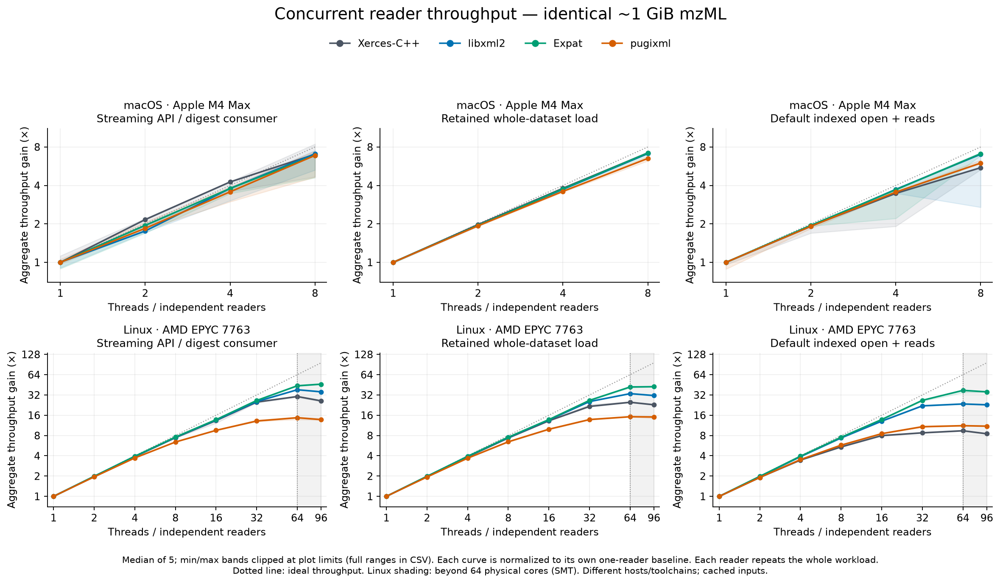
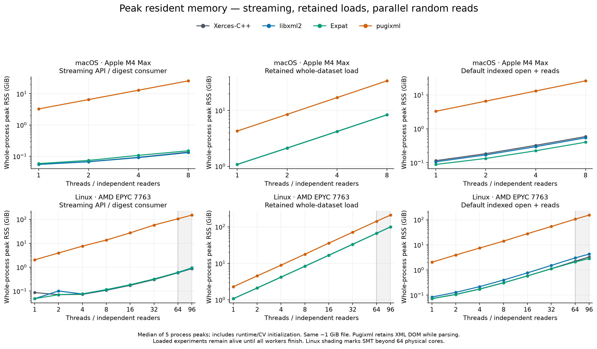

> Historical evaluation of frozen pre-review snapshots. Some listed implementation issues were subsequently fixed; see [the current handoff](HANDOFF.md). The later clock audit also flags seven historical macOS OpenMP elapsed-time discrepancies; raw rows remain unchanged.

# OpenMS 3.7 XML parser handoff

Follow-up to [Timo’s comment on #10623](https://github.com/OpenMS/OpenMS/issues/10623#issuecomment-6264980988). Three independent prototypes start at develop [`77cccda7caf40`](https://github.com/OpenMS/OpenMS/commit/77cccda7caf40b46a4919d33748450270eccd565): [libxml2](https://github.com/okohlbacher/OpenMS/tree/feature/xml-libxml2-poc), [Expat](https://github.com/okohlbacher/OpenMS/tree/feature/xml-expat-poc), [pugixml](https://github.com/okohlbacher/OpenMS/tree/feature/xml-pugixml-poc). Each replaces actual OpenMS XML event delivery and indexed mzML footer/fragment decoding; libxml2 also replaces XSD validation. **These are migration prototypes; all still depend on Xerces elsewhere.**

## Recommendation and compatibility

**Advance libxml2 for a complete migration; keep Expat for streaming/fragment parsing with separate DOM/XSD support and pugixml as a possible fragment-only option.** This ranks migration coverage and measured memory behavior, rather than raw parser speed:

| Candidate | Strengths | Costs and remaining issues |
|---|---|---|
| libxml2 | Incremental parsing, DOM and XSD 1.0; bounded streaming memory; faster indexed fragments in this adapter | Current streaming adapter trails Xerces; requires >=2.13; URI compatibility decision; residual Xerces infrastructure/mzIdentML DOM to migrate |
| Expat | Incremental parsing; small retained index-reader footprint; fast fragments | No XSD or DOM; needs another library for those roles; current full-file adapter trails Xerces |
| pugixml | Simple C++ DOM; fast indexed fragments | Whole-document event adapter has high RSS; incomplete XML well-formedness checks; no XSD; recursive DOM walk and encoding coverage need further work |
| Xerces baseline | Existing format/validation coverage; competitive full-file implementation | Remains the dependency this investigation aims to replace |

Both macOS ARM64 and Linux x86-64 builds/tests pass for all three. Windows was not run; the benchmark runner/launcher are POSIX-only, so this does not rank Windows portability. Independent-reader stress through 96 Linux threads is evidence for the tested usage; it does not establish shared-reader safety, parallel-validation behavior, race freedom, or exhaustive XML reliability. Pugixml’s malformed-reference acceptance was reproduced with 1.16 and is consistent with its [conformance documentation](https://pugixml.org/docs/manual.html#loading.w3c).

On **both platforms, all 22 bundled XSDs compile** with libxml2 and Xerces. Of 193 existing instance/schema pairs, 192 agree: 127 accepted and 65 rejected by both. Coverage is 15 bundled format schemas plus the standalone validator-test schema, not an instance test of every bundled XSD. A Windows drive/backslash `sourceFile@location` in `TargetedSpectraExtractor_13C1_spectra0to100.mzML` is accepted by Xerces but rejected as `xs:anyURI` by libxml2. Two minimal cases reproduce this difference and show normalized-URI acceptance: 195 comparisons total, two mismatch entries representing one compatibility issue. [Strict comparison](https://github.com/okohlbacher/OpenMS/tree/feature/xml-libxml2-poc/tools/xml-poc) deliberately fails; its known-difference mode permits only those exact cases. Ordinary mzML reading does not enable XSD validation.

## Performance across platforms

Medians of five runs on the same **1.05 GiB mzML**, 32,768 spectra. “Fast” skips global metadata; the default open scans XML for metadata. Query time excludes opening and covers 2,048 random spectrum requests. Throughput gain compares each backend with its own one-reader baseline, at 8 macOS / 96 Linux readers.

| Platform | Backend | Stream, 1 reader (s) | Fast query phase (s) | Fast open (ms) | Default open (s) | Max-reader stream throughput × |
|---|---|---:|---:|---:|---:|---:|
| macos | xerces | 2.926 | 0.293 | 85.9 | 1.246 | 7.00 |
| macos | libxml2 | 5.536 | 0.205 | 21.4 | 3.949 | 7.08 |
| macos | expat | 6.776 | 0.187 | 15.1 | 5.286 | 6.87 |
| macos | pugixml | 5.902 | 0.144 | 9.8 | 3.989 | 6.87 |
| linux | xerces | 4.949 | 0.408 | 128.9 | 2.214 | 26.15 |
| linux | libxml2 | 6.940 | 0.201 | 59.5 | 4.232 | 35.61 |
| linux | expat | 9.511 | 0.216 | 31.3 | 6.882 | 46.25 |
| linux | pugixml | 8.301 | 0.153 | 23.4 | 6.258 | 13.77 |

Xerces is fastest for single-reader streaming on both hosts. At 96 Linux readers, Xerces/libxml2/Expat process approximately 5.28/5.13/4.86 complete files per second; pugixml reaches 1.66. Xerces and libxml2 peak at 64 readers in this matrix (6.13/5.51 files/s), then lose throughput at 96. Expat improves from 4.61 to 4.86 files/s. Larger normalized gains for a slower one-reader backend do not imply higher absolute throughput.

Faster fragments do not imply a faster default `OnDiscMSExperiment` open: metadata scanning can dominate. The [indexed-path comparison](figures/indexed-path-comparison.png) separates these paths. The [fixed-work OpenMP graph](figures/openmp-scaling.png) measures one reader with varying array-decoding threads; parsing and digest consumption remain serial. Its x-axis is the requested per-reader team size; Linux retains extra initialization threads, and RSS includes them ([observation](results/linux/openmp-runtime-observation.json)). All thread-count results are in [comparison.csv](results/comparison.csv). Best observed Linux single-file OpenMP medians give only 1.00–1.25× speedup on plain mzML and 1.38–1.93× on binary-zlib data across backends; 96 is never the fastest tested setting. At eight threads on macOS, the corresponding ranges are 1.03–1.13× and 1.18–1.44×.

## RSS and reader overhead

The next table uses **8 macOS / 96 Linux independent readers**. Peak RSS is whole-process RSS, not input size or a native parser allocation. Whole-load experiments remain retained until every worker finishes. Fast/default random-read columns include opening. Context overhead subtracts the corresponding idle-process resident RSS and divides by readers; all reader objects remain retained after joining.

| Platform | Backend | Stream peak (GiB) | Whole-load peak (GiB) | Random-read peak: fast / default (GiB) | Resident overhead: fast / default (MiB/reader) |
|---|---|---:|---:|---:|---:|
| macos | xerces | 0.14 | 8.35 | 0.39 / 0.59 | 44.5 / 70.4 |
| macos | libxml2 | 0.13 | 8.34 | 0.34 / 0.54 | 36.7 / 64.0 |
| macos | expat | 0.15 | 8.36 | 0.19 / 0.40 | 18.5 / 45.9 |
| macos | pugixml | 25.81 | 33.86 | 0.24 / 25.85 | 25.4 / 624.8 |
| linux | xerces | 0.87 | 99.81 | 3.16 / 3.30 | 3.4 / 36.0 |
| linux | libxml2 | 0.91 | 99.75 | 1.86 / 4.31 | 9.7 / 37.4 |
| linux | expat | 0.94 | 99.77 | 0.50 / 2.84 | 5.4 / 35.2 |
| linux | pugixml | 151.01 | 209.76 | 0.99 / 153.45 | 10.8 / 208.6 |

Pugixml’s full-file path materializes an XML DOM, including when OpenMS requests streaming or metadata only. Its fragment path avoids that full-file allocation. See [retained reader overhead](figures/reader-context-memory.png) and [OpenMP RSS](figures/openmp-memory.png). Context estimates include indexes, metadata and allocator retention, rather than just parser structs. Linux resident samples use approximate `/proc/self/statm` accounting; they can exceed the separately recorded `wait4` peak. These counters are kept distinct ([Linux documentation](https://man7.org/linux/man-pages/man5/proc_pid_statm.5.html)).

## Evidence, scaling limits and next steps

**7,040 completed measurements: 2,560 macOS and 4,480 Linux, without failures or decoded-data mismatches in the final measurement matrices.** On each platform, the baseline passes 25 affected existing class tests; each prototype passes those 25 plus its focused test. The shared three-case smoke suite passes for each backend. A 1,048,576-peak spectrum exercises a binary text node larger than 10 MB, with matching decoded digests and successful actual OpenMS XSD validation for all backends. Metadata checks cover selected fields and existing tests, not exhaustive cross-backend metadata equality.

macOS: Apple M4 Max, 16 cores, 128 GiB, Apple Clang 21. Linux: ibminode05, AMD EPYC 7763, 64 physical/128 logical CPUs, about 995 GiB, GCC 13.3. Both use Release `-O3 -DNDEBUG`, C++23, Xerces 3.3.0, libxml2 2.15.4, Expat 2.9.0 and pugixml 1.16. Linux affinity 0–95 spans **64 physical cores plus 32 SMT siblings**, within one NUMA node; 96 threads are not 96 physical cores. Threads share that allowed CPU mask; individual workers are not pinned to distinct cores. Hardware/compiler differences prevent attributing cross-platform differences solely to the OS.

Each concurrent reader repeats the same cached input or random-query sequence: throughput/weak scaling, not fixed-total-work speedup or cold-storage scaling. OpenMP is one thread during independent-reader measurements. Six byte-identical inputs cover small/medium/large generated mzML, binary zlib, outer gzip (streaming only), and tracked BSA data. Timings include decoding and native-ID/coordinate/intensity digest consumption after common tiny-input initialization; process RSS includes initialization. Five randomized repetitions provide min/max/median, not confidence intervals. [README](README.md) describes reproduction, provenance and runtime setup issues; [raw results and logs](results/) retain all measurements. Successful Linux scratch builds/runs were copied and verified before [task-only cleanup](results/linux/scratch-cleanup.json).

Before production: profile the compatibility callback/transcoding path, decide URI policy, finish residual Xerces removal, and test Windows, sanitizers, encoding and malformed-input coverage. `XMLAttributes` changes layout, requiring SDK consumers to rebuild. Libxml2’s indexed fragment path raises size/depth limits for large arrays while disabling external entities and limiting amplification; review that policy for untrusted inputs. This is not a blanket claim about schema import resolution or XML security.
